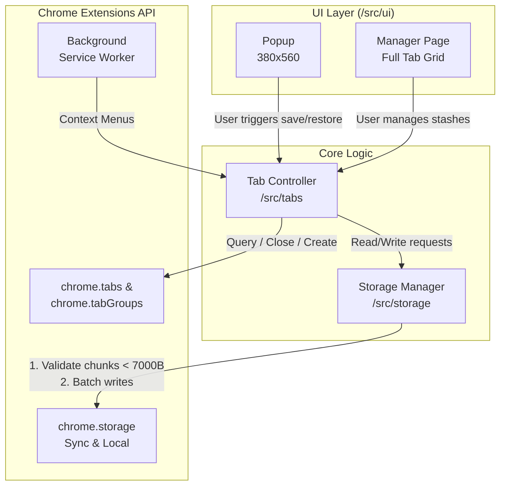

# TabStash

TabStash is a Manifest V3 Chrome extension that saves the user's open tabs into named "stashes", closes those tabs to free RAM, and lets the user restore a stash later on any device signed in to Chrome. 

**Zero backend, no accounts, no analytics, no network calls.**

## Features
- **Cross-device Sync:** Uses `chrome.storage.sync` to sync stashes across devices.
- **Smart Quota Management:** Automatically batches writes and chunks data to respect Chrome's strict 8KB per item and 120 writes/min limits.
- **Graceful Fallback:** Falls back to `chrome.storage.local` if sync storage is full or rate-limited.
- **Native Tab Groups:** Preserves Chrome's native colored tab groups (title, color, collapsed state).
- **RAM Optimization:** Safely closes tabs only *after* a successful save is confirmed.

## Architecture

TabStash separates UI rendering, tab manipulation, and storage management into distinct layers to ensure safe operations and strict type safety.



## Data Model

To bypass `chrome.storage.sync` limitations (100KB total, 8KB per item), TabStash uses an Index-Chunk model.

*   **Index (`index`):** Stores metadata for all stashes (`id`, `name`, `createdAt`, `tabCount`, `store`, `chunks`).
*   **Chunks (`s_<id>_<n>`):** JSON arrays of tab records. Each chunk is strictly kept under 7000 bytes (measured via `TextEncoder`).
*   **Tab Records:** Highly minified keys to save space:
    `{ u: url, t: title, p: pinned, g: groupId }`.
*   **Group Records:** Stored in chunk `0` containing group metadata
    `{ i, title, color, collapsed }`.

*Note: Favicons are not stored. They are rendered natively using Chrome's internal `_favicon` API.*

## Development Setup

### Prerequisites

*   Node.js 18+
*   npm or pnpm

### Installation

1.  Clone the repository:

    ```bash
    git clone [https://github.com/yourusername/tabstash.git](https://github.com/yourusername/tabstash.git)
    cd tabstash
    ```

2.  Install dependencies:

    ```bash
    npm install
    ```

3.  Start the development server (with HMR):

    ```bash
    npm run dev
    ```

### Loading the Extension in Chrome

1.  Open Chrome and navigate to `chrome://extensions/`.
2.  Enable **Developer mode** in the top right corner.
3.  Click **Load unpacked** and select the `dist` folder generated by the dev script.
4.  The extension will automatically reload when you save files in your IDE.